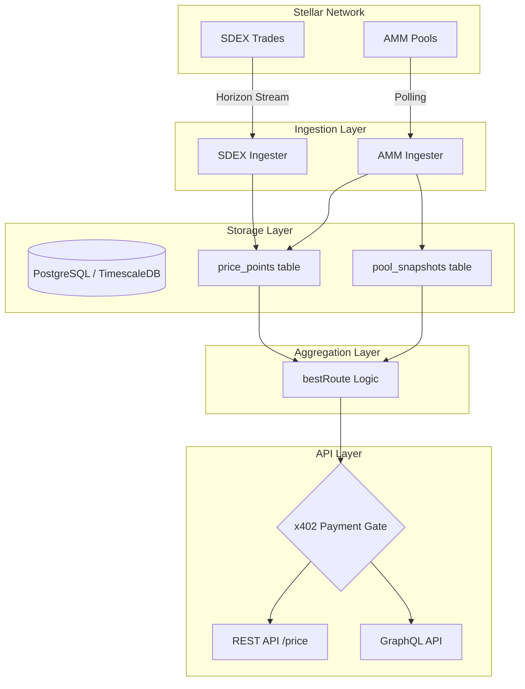

# Architecture Overview

Lens is a unified price aggregation engine for the Stellar network. It bridges the gap between Stellar's Classic Order Book (SDEX) and Liquidity Pools (AMM) by providing a single source of truth for asset pricing, VWAP calculations, and optimal trade routing.

## Data Flow

The following diagram illustrates how data flows from the Stellar network through our ingesters, into the database, and finally out through our API layers.

## System Components

### 1. Ingestion Layer
Lens utilizes two distinct ingestion strategies to maintain up-to-date pricing data:

*   **SDEX Ingester**: Streams trades directly from Stellar Horizon for watched asset pairs. It processes individual trade events in real-time, extracting price and volume data which is then persisted to the `price_points` table.
*   **AMM Ingester**: Polls Horizon for liquidity pool snapshots and recent AMM trades. It stores pool reserves (Asset A/B amounts) in `pool_snapshots` and individual trades in `price_points`. This allows Lens to calculate spot prices based on reserve ratios even when no trades have occurred recently.

### 2. Storage Layer
Data is stored in a PostgreSQL database optimized with declarative range partitioning and time-series indexing.
*   **`price_points`**: A unified table for all trade events across both SDEX and AMM, range-partitioned by `timestamp` into daily partitions (`price_points_yYYYYmMMdDD`). Automatic background workers pre-create future partitions ahead of need. Partition retention via metadata-only `DROP TABLE` operations is opt-in (`PRICE_POINTS_DROP_EXPIRED=true`, default: off) to safeguard raw historical records until rollups are completed (#231). Query execution plans on recent time windows leverage PostgreSQL partition pruning to scan only active partitions and skip all historical data.
*   **`pool_snapshots`**: Stores the reserve state of AMM liquidity pools, which is critical for slippage estimation and constant-product price calculations.

### 3. Aggregation & Routing (`bestRoute` & Volume)
When a price is requested, the `bestRoute` engine compares the available liquidity on both SDEX and AMM:
*   **SDEX Pricing**: Fetches real-time path payment quotes from Horizon to determine the effective rate for a specific trade size.
*   **AMM Pricing**: Uses the constant-product formula (`x * y = k`) against the latest pool snapshots to estimate the output and slippage.
*   **Optimal Routing**: Compares the rates and recommends the best execution path (SDEX, AMM, or a SPLIT for large orders) to minimize slippage for the user.
*   **Venue Classification & Volume Accounting**: Venues in the venue registry are categorized as either primary markets (SDEX, native AMM, Soroswap) or aggregators (Aquarius). Aggregate volume metrics report labelled net (primary markets) and gross figures to eliminate trade double-counting. See [venues.md](./venues.md) for details.

### 4. API Layer & x402 Payment Gate
The system exposes both REST and GraphQL interfaces. To monetize the high-fidelity data, Lens implements the **x402 protocol**.

The **x402 Payment Gate** is a middleware that intercepts requests to premium endpoints (like `/price`, `/pools`, and `/candles`). If a valid `x-payment` header containing a signed Stellar transaction is not present, the server returns a `402 Payment Required` status along with the payment requirements (price, destination address, and network). This ensures that every high-value API call is backed by a micropayment, enabling a "pay-per-query" business model.

## Time Model: Observation Time vs Source Time

Lens explicitly separates **observation time** from **source time** to prevent conflating chain/exchange clocks with local ingestion clocks:

| Field | Type | Description |
|---|---|---|
| `observed_at` | `DateTime` (non-null) | The UTC timestamp when Lens recorded/ingested the sample (Lens wall-clock). |
| `source_time` | `DateTime?` (nullable) | The native timestamp provided by the source venue itself. `null` for sources with no native timestamp. |
| `ledger` | `Int` | Stellar ledger sequence number, kept strictly separate from time fields. |

### Venue Source Time Capabilities

Every venue adapter explicitly declares its `sourceTimeCapability`:

| Venue / Adapter | Status | Semantic | Description |
|---|---|---|---|
| **SDEX** | `provided` | `ledger_close` | Stellar Horizon ledger close time of the executed trade. |
| **AMM (Trades)** | `provided` | `ledger_close` | Stellar Horizon ledger close time of the pool trade. |
| **AMM (Reserve Snapshots)** | `unavailable` | - | State snapshot; `source_time` is `null`. |
| **Soroswap AMM** | `unavailable` | - | Soroban contract simulation; `source_time` is `null`. Never fabricates timestamps. |
| **Aquarius AMM** | `unavailable` | - | Pool API state snapshot; `source_time` is `null`. Never fabricates timestamps. |
| **CEX Adapters** | `provided` | `exchange_timestamp` | Native exchange-reported ticker/trade timestamp. |

### Bucketing Rationale

All candle aggregation (`/candles`), time-window filtering, TWAP, and VWAP calculations key on **`observed_at`** (observation time).

**Why observation time?**
1. **Universality across venues**: Snapshot-only venues (Soroswap, Aquarius, AMM reserve snapshots) have no native trade timestamps (`source_time = null`). Bucketing on source time would drop or misrepresent state snapshots.
2. **Single monotonic timeline**: Observation time provides a unified, monotonic reference clock across decentralized order books, AMMs, and off-chain exchanges, avoiding clock skew, Horizon polling latency skews, and historical reorg gaps.

